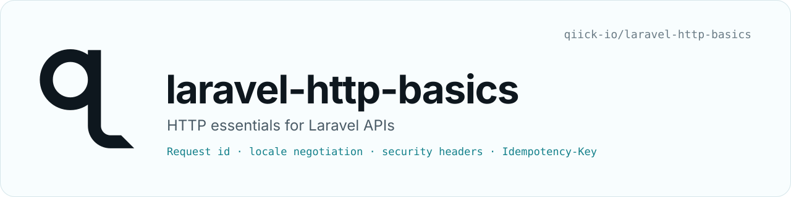

<p align="center">
  <picture>
    <source media="(prefers-color-scheme: dark)" srcset=".github/assets/header-dark.svg">
    <source media="(prefers-color-scheme: light)" srcset=".github/assets/header-light.svg">
    
  </picture>
</p>

# qiick/laravel-http-basics

> **In development. Not released and not on Packagist yet: do not depend on it.**

Shared HTTP runtime for qiick Laravel products: trusted `X-Request-Id`,
Accept-Language / `Content-Language` negotiation, configurable security headers,
and `Idempotency-Key` (middleware + store). Thin helpers for fleet `error`
augmentation and machine-door JSON classification — without owning product error
enums.

Part of the qiick fleet. Binding design:
`projects/qiick/packages/laravel-http-basics-design.md` in the knowledge base
(overlays: `decisions/2026-11-20-fleet-contracts.md`,
`decisions/2026-11-20-core-hardening.md`, `conventions/standards-register.md`).

## Status

Pre-`0.1.0`. Public APIs may change in any 0.x release; see [UPGRADING.md](./UPGRADING.md).
Do not require this package from production apps until a tagged release lands on
Packagist (Packagist publish only after Luca’s go).

## Requirements

- PHP `^8.3` with `ext-fileinfo` (upload MIME sniffing)
- Illuminate cache / contracts / http / support `^12.0 \|\| ^13.0` (never
  `laravel/framework`)

## Install (when published)

```bash
composer require qiick/laravel-http-basics
php artisan vendor:publish --tag=http-basics-config
```

Register request-id, locale and security middleware **globally**. Idempotency is
per-route after throttle / auth / scope / cost. Products wire
`ExceptionErrorCodeAugmenter` through their own bootstrap (no Foundation types in
this package).

### Fleet error shape (landed)

```php
use Qiick\HttpBasics\Errors\ExceptionErrorCodeAugmenter;
use Qiick\HttpBasics\Errors\MachineDoorJson;

// shouldRenderJsonWhen — machine doors only
$exceptions->shouldRenderJsonWhen(MachineDoorJson::whenCallback(['api/*', 'mcp', 'mcp/*']));

// respond() — add top-level `error` on machine-door JSON ≥400, never overwrite.
$exceptions->respond(fn ($response, $exception, $request) => app(ExceptionErrorCodeAugmenter::class)
    ->respond($response, $exception, $request));
```

With `http-basics.errors.format=problem_details` (chosen once per product), the
same binding renders every machine-door error response as RFC 9457
`application/problem+json`, an HTML error page included: `type` (`about:blank`,
or `problem_type_base_uri` plus the code), `title`, `status`, `detail` (the fleet
`message`), and `instance` when a `ProblemInstanceResolver` is bound. Every other
fleet member stays as an extension member: `error` (a product's own code is
kept), `errors`, `documentation_url`. Status and headers (`Retry-After`,
`Allow`) are kept. The golden shapes are in `tests/Feature/golden/problem-details/`.

Idempotency refusals already use `ErrorRenderer` with translated `message` and a
stable `error` code from the shared `ErrorCode` enum (see `docs/error-codes.md`).
The augmentor covers framework and product exceptions the same way.

### Request id (landed)

```php
use Qiick\HttpBasics\RequestId\AssignRequestIdMiddleware;
use Qiick\HttpBasics\RequestId\RequestIdPropagator;

// bootstrap/app.php — OUTERMOST global middleware (prepend), so 401/404/405/419/429/503,
// maintenance and CORS preflight responses carry X-Request-Id.
$middleware->prepend(AssignRequestIdMiddleware::class);

// Outbound (only when http-basics.request_id.outbound.allowed_hosts is set)
app(RequestIdPropagator::class)->applyTo($pending, $url);
```

| Config / env | Default | Meaning |
| --- | --- | --- |
| `HTTP_BASICS_REQUEST_ID_ACCEPT_FROM` | `trusted_proxy` | Keep inbound id only from a trusted proxy hop (`any` / `never` also valid). |
| `HTTP_BASICS_TRUST_WILDCARD_PROXIES` | `false` | When TrustProxies is `*` / `**` (Cloud/Forge/Vapor), still reject client ids unless true. |
| `HTTP_BASICS_OUTBOUND_HOSTS` | empty | Comma-separated `host` or `host:port`; empty = never propagate; `*` = all hosts. |
| `http-basics.request_id.accept_pattern` | `RequestId::PATTERN` | Must require ≥1 alphanumeric; punctuation-only tokens are rejected. |

The id is stored in **visible** Context as `request_id` (Laravel logs it and queued jobs inherit it). Provenance (`generated` / `trusted_proxy` / `client`) stays in hidden Context.

Trust is computed by `ConfigTrustedProxyDetector` from the same sources as TrustProxies (`TrustProxies::at()` and `trustedproxy.proxies`) via `IpUtils::checkIp` on `REMOTE_ADDR`. It does **not** call `$request->isFromTrustedProxy()`, so middleware order and Octane static request state cannot flip the decision.

### Locale (landed)

Locale cookie and user preference only work **after** `EncryptCookies` +
`StartSession`. Register on the `web` and `api` groups (Laravel 12 / 13
`bootstrap/app.php`). Prepend globally as well when maintenance / early errors
must carry `Content-Language`.

```php
use Qiick\HttpBasics\Locale\SetLocaleMiddleware;
use Qiick\HttpBasics\Locale\LocaleNegotiator;

// bootstrap/app.php
->withMiddleware(function (Middleware $middleware) {
    // Web: after EncryptCookies + StartSession (group defaults) so cookie / user work.
    $middleware->web(append: [
        SetLocaleMiddleware::class,
    ]);

    // API / machine doors: Accept-Language negotiation only (no cookie).
    $middleware->api(append: [
        SetLocaleMiddleware::class,
    ]);

    // Optional but recommended: Content-Language on maintenance 503 and errors
    // before group middleware (same reason AssignRequestId is prepended).
    $middleware->prepend(SetLocaleMiddleware::class);
})

// After API-key / principal auth (inside the stack, before Content-Language):
app(LocaleNegotiator::class)->applyPrincipalLocale($request, $principal->locale);
```

Default machine doors include `api` and `api/*` (so `/api` itself negotiates).
`Vary: Accept-Language` is set whenever that header was **read** on a machine
door, not only when it won.

| Config / env | Default | Meaning |
| --- | --- | --- |
| `HTTP_BASICS_SUPPORTED_LOCALES` | empty → app locale + fallback | Comma-separated supported tags (case-sensitive). |
| `HTTP_BASICS_LOCALE_MAX_HEADER_BYTES` | `1024` | Oversize `Accept-Language` is ignored (fall through). |
| `HTTP_BASICS_LOCALE_MAX_LANGUAGES` | `20` | Too many ranges (counted before dedupe) → treat header as absent. |

### Security headers (landed)

Register **globally with prepend** (same reason as request-id / locale) so
maintenance 503 and early errors still get the defense headers.

```php
use Qiick\HttpBasics\Security\SetSecurityHeadersMiddleware;

// bootstrap/app.php — prepend globally so 401/404/405/419/429/503 and
// maintenance responses carry nosniff / Referrer / Permissions (and web XFO +
// CSP). Machine doors stay baseline-only.
$middleware->prepend(SetSecurityHeadersMiddleware::class);
```

| Config / env | Default | Meaning |
| --- | --- | --- |
| `HTTP_BASICS_SECURITY_ENABLED` | `true` | Master switch. |
| `HTTP_BASICS_CSP_MODE` | `enforce` | `enforce` / `report-only` / `off` / `both`. |
| `HTTP_BASICS_CSP` | empty → Vite-friendly default | Full CSP override (verbatim). |
| `HTTP_BASICS_CSP_REPORT_URI` | empty | Appended to the built/override CSP string before set. |
| `HTTP_BASICS_CSP_NONCE` | `false` | Strict CSP: a per-request nonce plus `'strict-dynamic'` in the built `script-src`, no `'unsafe-eval'`. |
| `security.csp.script_hashes` | `[]` | `sha256-…` / `sha384-…` / `sha512-…` hashes of allowed inline scripts; needs `HTTP_BASICS_CSP_NONCE=true`, checked at boot. |
| `HTTP_BASICS_HSTS_MAX_AGE` | `0` | HSTS only when greater than 0 and the request is HTTPS; proxy usually owns this. |
| `HTTP_BASICS_BASELINE_ON_API` | `true` | Machine doors still get nosniff / Referrer / Permissions. |

With `HTTP_BASICS_CSP_NONCE=true` the middleware takes the request's nonce from
`CspNonceProvider` before the handler runs and hands it to `Vite::useCspNonce()`, so
every tag `@vite` renders carries it. Other inline scripts need the same nonce
(`nonce="{{ Vite::cspNonce() }}"`) or a hash in `security.csp.script_hashes`.
`'unsafe-inline'` stays in `script-src` only as the fallback for pre-CSP2 browsers,
which ignore nonces. `style-src` keeps `'unsafe-inline'`: a style nonce would block the
inline `style` attributes most front ends render. A full override (`HTTP_BASICS_CSP`) is
sent as written, without a nonce.

Before turning the nonce on, give every inline script in your layout the nonce. The
starter kits' appearance script in `resources/views/app.blade.php`, which applies the
dark theme before the page paints, is one: without the nonce it is blocked and the theme
flashes or does not apply.

```blade
<script nonce="{{ Vite::cspNonce() }}">
    (function () { /* appearance script */ })();
</script>
```

Script hashes are refused at boot without the nonce: a hash makes CSP2+ browsers ignore
`'unsafe-inline'`, so every other inline script would stop running. Do not keep pages
with a nonce in a shared cache (a full-page response cache, a CDN with
`Cache-Control: public`): every visitor would get the same nonce, and an injection that
knows it would run.

Existing HSTS / XFO / Referrer / Permissions / nosniff on the response are never
replaced. If the response already has **either** `Content-Security-Policy` or
`Content-Security-Policy-Report-Only`, this package adds **neither** CSP header.

### Idempotency (landed)

```php
use Qiick\HttpBasics\Contracts\CredentialBucketResolver;
use Qiick\HttpBasics\Idempotency\HandleIdempotencyMiddleware;

// Per route, after throttle / auth / scope / cost:
Route::post('/api/items', ...)->middleware(HandleIdempotencyMiddleware::class);

// Non-replayable routes that issue secrets (API keys, invites, password reset):
Route::post('/api/keys', ...)->middleware(HandleIdempotencyMiddleware::class.':replayable=false');

// Product bucket from server state (never request input):
app()->bind(CredentialBucketResolver::class, MyCredentialBucketResolver::class);
```

| Config / env | Default | Meaning |
| --- | --- | --- |
| `HTTP_BASICS_IDEMPOTENCY_STORE` | `cache` | `cache` or `database` (see `docs/reference-schema.md`). |
| `HTTP_BASICS_IDEMPOTENCY_TTL` | `86400` | Completed record TTL from completion time. |
| `HTTP_BASICS_IDEMPOTENCY_LOCK_TTL` | `60` | Must be > `max_handler_seconds`. |
| `HTTP_BASICS_IDEMPOTENCY_KEY_FORMAT` | `uuid` | `uuid` or `sf-string`. Both read the RFC 9651 String of draft-ietf-httpapi-idempotency-key-header-09 (`"8e03…"`, quotes and `\"` / `\\` escapes removed before storage) or the same key bare; `uuid` then requires a UUID. |
| `HTTP_BASICS_IDEMPOTENCY_ANON_ENABLED` | `false` | Public writes via HMAC bucket (`ip`, `user_agent`, `route`). |
| `HTTP_BASICS_IDEMPOTENCY_ANON_SECRET` | — | Required ≥32 bytes when anon is enabled. |

Refusals use fleet JSON (`message` + `error`): `idempotency_key_required`,
`idempotency_key_invalid`, `idempotency_unsupported_media` (415),
`idempotency_payload_mismatch` (422), `idempotency_in_progress` (409 + `Retry-After`),
`idempotency_unavailable` (503). Replays force the **current** `X-Request-Id` and strip
stale `X-RateLimit-*` headers.

A key is stored per bucket, not per route: the record is identified by
`(bucket, key)` (the database store's unique `(bucket, key_hash)`), and the method and
path live in the fingerprint. Reusing a key on another route therefore answers
`idempotency_payload_mismatch` (or 409 while the first is in flight); it never
replays another route's response. Clients should send a fresh key per operation.

A custom `IdempotencyStore` receives an `IdempotencyContext` with every claim: the
key format, the fingerprint version, the request id, and room for a trace id, a
credential public id and namespaced metadata. The database store writes them to the
record (see `docs/reference-schema.md`). The cache store keeps only what a replay needs
and drops the rest, so an audit trail of idempotent operations (who, which request,
which trace) requires `HTTP_BASICS_IDEMPOTENCY_STORE=database`.

When the response cannot be stored, the store seals the key so a retry gets
`idempotency_not_replayable` instead of running the handler again. If the record
itself cannot be written either (a database outage, a cache item too large), a
separate `:sealed` cache entry carries the seal; only when that write fails too does
the request end with a 503 whose key can run again once it goes stale.

**Handlers must be atomic.** A 5xx, a 429 or an exception frees the key, so a retry
runs the handler again. That is only safe when a failing handler leaves nothing
behind: wrap its writes in one database transaction, make no external call (payment,
email, webhook) before the point where it can still fail, or make those calls
idempotent themselves (pass the same key downstream). A handler that writes or calls
out and then throws will run twice.

**A handler slower than its budget can run twice.** PHP-FPM cannot stop a running
handler, so `max_handler_seconds` is checked after it returns. Past the budget the lock
may have expired, and another request may have claimed the key and run the handler
again. The middleware then seals the key (retries get `idempotency_not_replayable`) and
answers 503 instead of the handler's response, though the handler's work is done. Keep
the effect itself idempotent: write it in one transaction keyed by the operation (a
unique column the second run hits), or record it in an outbox table in that
transaction and let a worker perform it once.

With the database store, schedule the prune of expired records (Laravel 11+,
`routes/console.php`):

```php
use Illuminate\Support\Facades\Schedule;

Schedule::command('http-basics:prune-idempotency')->hourly()->onOneServer();
```

`--dry-run` counts what would be deleted. `model:prune` against
`Qiick\HttpBasics\Idempotency\IdempotencyRecord` does the same job.

On machine doors the fingerprint includes the locale the response is served in, so
a retry that negotiates to the same locale replays (`it-CH,it;q=0.9` and `it`; an
unsupported `fr`, no header and `en` when `en` is the default). The database store
treats an `expires_at` it cannot read as never expiring, so such a row keeps
answering instead of letting the handler run again.

## Threat model (short)

| Topic | Contract |
| --- | --- |
| Log injection / header smuggling | Charset + single-value `X-Request-Id` (≥1 alphanumeric); provenance in hidden Context only (`generated` / `trusted_proxy` / `client`). |
| Correlation spoofing | Default inbound `accept_from=trusted_proxy`; outbound host allowlist empty by default (no propagation). |
| Wildcard TrustProxies (`*` / `**`) | Common on Cloud/Forge/Vapor. Client ids are **not** trusted under `*` unless `trust_wildcard_proxies=true` (default false). |
| Outbound leak | Allowlist decides at send time from the real URI; cross-host/port redirects strip `X-Request-Id`; caller-supplied header wins (no duplicate). |
| Cross-credential replay | Server-side credential bucket + owner lease; unique `(bucket, key_hash)`; never a request-controlled bucket. |
| Anonymous bucket | Best-effort de-duplication, **not** an identity boundary; HMAC secret rotatable (rotation invalidates anon records); depends on TrustProxies. |
| Secret replay | Route `replayable=false` + header deny-list + text/JSON only; API-key issuance must be non-replayable. |
| Retry storms / double execution | 409 while lock held; lease-conditional complete. A cache store that evicts or loses the in-progress marker or the `:sealed` entry (an LRU cache under memory pressure, a restart without persistence) lets a retry run the handler again: use a shared, persistent cache (Redis with persistence and no eviction of these keys) or the database store for idempotency. Config requires `max_handler_seconds` **strictly less than** store `lock_ttl_seconds` so a route cannot claim a handler budget that outlives the lock. Soft overrun remains possible: `max_handler_seconds` is checked **after** `$next` returns, so a hung or wall-clock-skewed handler can still hold the request past lock expiry; once the lock and `stale_after` elapse, another worker may claim `New` (crash-recovery takeover by design). Bound handlers and keep lock TTL above real p99 latency. |
| Cache poisoning | `Vary: Accept-Language` whenever Accept-Language was read on a machine door; authenticated responses documented `Cache-Control: private`. |
| Proxy trust | Same configured proxies as TrustProxies, evaluated independently of middleware order / request static state. |

## CORS (fleet)

Use Laravel's `HandleCors` (Fruitcake). Prepend
`Qiick\HttpBasics\Cors\ConfigureCorsMiddleware` so a product
`AllowedOriginsResolver` can overwrite `cors.allowed_origins` per request
(externa's pattern). With `supports_credentials` true, the provider refuses to
boot on any origin containing `*`, any `allowed_origins_patterns` entry, and
`*` in `allowed_headers` or `exposed_headers`. That includes subdomain
wildcards: `https://*.example.com` is forbidden with credentials, so list each
origin (`https://app.example.com`, `https://admin.example.com`), or return them
per request from the resolver. The check always runs at boot; there is no
switch to turn it off. The middleware applies the origin guard again on every
credentialed request, to resolver output and to config alike. Resolver
responses get `Vary: Origin`, merged into every existing `Vary` line; a shared
cache in front must honour it.

Merge `CorsHeaderCatalog::exposedHeaders()` / `allowedRequestHeaders()` into
`config/cors.php`. Catalog includes `X-Request-Id`, `X-RateLimit-*`,
`Retry-After`, `Deprecation`, `Sunset`, `Content-Language`, `Vary`, `Link`,
`Location`, and `Idempotent-Replayed`. Origin enforcement with API keys stays
in the product.

## Uploads (floor)

`Qiick\HttpBasics\Uploads\UploadValidator` (or the `SafeUpload` rule) checks an
upload against `http-basics.uploads.contexts.<context>`: the hard floor on every
filename suffix and on the sniffed MIME, the extension and MIME allowlists,
`max_bytes`, magic bytes, the archive budget, and the bound `MalwareScanner`.
The storage name is a random id plus an extension chosen from the sniffed MIME,
never the client suffix.

SVG is refused unless a context sets `allows_svg: true`, and then the package does
**not** sanitize it: an SVG can carry `<script>`, event handlers and links that run
in your origin when the file is opened. With `allows_svg`, serve uploaded SVGs as a
download (`Content-Disposition: attachment`), or from a separate origin with no
cookies (a storage bucket domain), or sanitize them in the product before storing.
Never serve them inline from the app's own origin.

Archives are refused by default. A context accepts them only with
`allows_archives: true`; otherwise a name with an archive suffix (`zip`, `7z`,
`tar.gz`, `docx`, `xlsx`, `odt`, `epub`, `apk`, `deb`, `rpm`, …, see
`HardFloor::archiveExtensions()`), a sniffed archive MIME
(`HardFloor::archiveMimeTypes()`, plus every OOXML and OpenDocument type), or a
file libzip opens as a ZIP (a PDF+ZIP polyglot included) is refused with
`upload_forbidden_type`. This holds even when both archive budgets are `null`.
Brotli, shar and uuencoded tar have no magic bytes, so only their suffix can
catch them.

**With `allows_archives`, the package checks an archive's structure; it does not
make extracting it safe.** A product must never extract uploaded archives with a
streaming reader (libarchive or `bsdtar` from a pipe, Java's `ZipInputStream`,
Node's `unzipper`): read them through the central directory, as libzip does, and
validate every extracted file as its own upload. Safe extraction is out of scope
for 1.0.

Archive budget: any file libzip opens as a ZIP (docx, jar and polyglots
included) is inflated in streaming and its real bytes are counted, because the
sizes in its headers are attacker-controlled. Reading stops at `size ×
max_uncompressed_ratio`, capped by `max_uncompressed_bytes`; either limit works
alone, a zero or negative limit allows nothing, and leaving both `null` turns
the budget off where archives are allowed. An archive over 10 000 entries is
refused before any entry is read. Only ZIP is measured: with archives allowed, a
`.gz`, `.7z` or `.tar.xz` bomb is not.

Streaming readers walk the local headers instead of the central directory libzip
reads, so the two must describe the same bytes. Every local header must sit
exactly at the offset its directory entry gives, the headers must follow each
other with no byte left over from byte 0 to the central directory, every local
header must agree with its entry, every data descriptor must repeat the entry's
CRC and sizes, the directory must end where the only end record starts, and that
record's comment must run to the end of the file. A stored entry with a data
descriptor is refused outright, because only the descriptor marks where its data
ends. A local header hidden in another one's extra field or data, a contradicting
local name, data before the first entry or after the end record, and a second end
record are refused with `upload_content_mismatch`, as are a corrupt archive, a CRC
mismatch, and an encrypted entry. Two kinds of honest archive are refused too,
because their layout cannot be told apart from a crafted one: Info-ZIP output
written to or from a pipe (`… | zip - -`, which adds a ZIP64 end record next to a
classic one) and `bsdtar --format=zip` written to stdout (zero padding after the
end record). Re-create such archives with a seekable writer.

A file libzip cannot open is refused with `upload_content_mismatch` when its
last 64 KiB hold an end record that a tolerant reader (unzip, Python's
`zipfile`) would follow: one with a central directory right before it, or a
ZIP64 one. A stray `PK\x05\x06` in an ordinary file is not refused. Residual
risk: a polyglot followed by more than 64 KiB of trailing data is not measured;
unzip, bsdtar and Python's `zipfile` all refuse to open such a file.

Entry names with a `..` segment, an absolute or drive path, or a control
character, and symbolic link entries, are refused with `upload_forbidden_type`.
Nested archives are counted by their compressed bytes and are not opened. The
floor does not check entry names against the extension floor (`shell.php`
inside a zip passes): a product that unpacks an archive must validate every
extracted file as its own upload.

A floor cannot catch polyglots (`GIF89a<?php …`, a PNG header followed by
HTML). Serve uploads with `X-Content-Type-Options: nosniff` and
`Content-Disposition: attachment`, or from a cookieless domain, and re-encode
images a browser will render inline.

## Development

```bash
composer update
composer test      # Pest
composer lint      # Pint
composer analyse   # PHPStan level max
```

No `composer.lock` is committed (library). CI resolves with `--prefer-lowest` and
stable across PHP 8.3/8.4/8.5 × Laravel 12/13. Mutation targets from the design
run with `pest --mutate` (per-class MSI ≥ 95%).

## Public API

`docs/public-api.md` lists what is public: classes, interfaces and enums marked
`@api`, config keys, environment variables, the Artisan command, publish tags, the
migration and the wire formats. Everything else in `src/` is `@internal`.

## Deprecation policy

See the [public API deprecation policy](docs/public-api.md#deprecation-policy)
for notice periods, release rules, and upgrade guidance.

## Security

Private vulnerability reporting: see [SECURITY.md](./SECURITY.md).

## License

MIT. See [LICENSE](./LICENSE).
